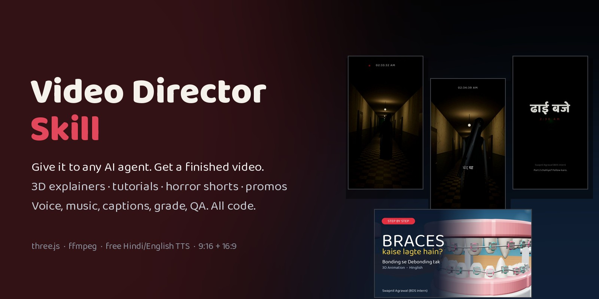
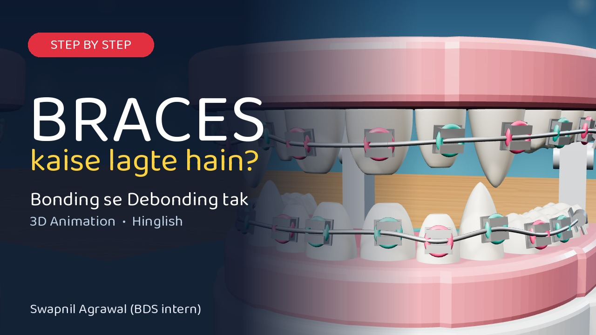
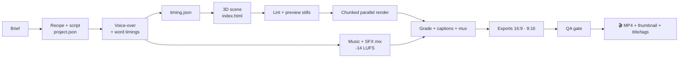

<div align="center">



# 🎬 Video Director Skill

### Paste one prompt into any AI coding agent. Get back a finished, YouTube-ready video.

**3D explainers · step-by-step tutorials · dental/medical procedures · horror shorts · product promos · kinetic-type reels**


Works with **Claude Code · Codex · Cursor · Gemini CLI · Hark** — or any agent that can run a shell.

</div>

---

## 👀 Made with this skill

<table>
<tr>
<td width="42%" align="center">


**ढाई बजे · 2:30 AM** — Hindi horror Short (9:16, 64 s)<br>
*Every time the bulb flickers, she gets closer.*<br>
[▶ Watch the preview](docs/showcase/dhai-baje-preview.mp4) · [Source](examples/dhai-baje/)

</td>
<td width="58%" align="center">



**Braces kaise lagte hain?** — 3D dental tutorial (16:9, Hinglish)<br>
*Bonding to debonding, step by step, with callout labels.*<br>
[Source](examples/braces-tutorial/)

</td>
</tr>
</table>

> The horror short above was written, voiced, lit, scored, captioned, graded and QA-checked by an agent using this repo — in under an hour, with **zero paid APIs and zero stock footage.**

---

## 🕺 3D characters that move (new)

<p align="center"></p>

`template/character3d.js` gives every video real character acting, built only from three.js primitives (no SVG, no sprites). The motion system is ported from the Rigpop family ([rigpop-motion](https://github.com/swapagrawal14/rigpop-motion), [rigpop-agents](https://github.com/swapagrawal14/rigpop-agents)) and rebuilt for 3D:

- **Always alive:** breathing, weight-shift sway, head drift, blinks, eye saccades
- **Locomotion:** walk, sneak and run between named marks
- **13 clips** with anticipation and overshoot: wave, point, thumbs, nod, shake, laugh, shrug, think, shock, cower, bow, sip, jump
- **Faces:** 11 expressions plus visemes (rest, M, A, E, O) from the VO via `scripts/mouth.py`
- **Stage directions:** `{at: "namaste", do: "wave"}`, plus auto-gestures on English and Hindi keywords
- **Look-at and two-bone IK** for reaching

Docs: [docs/CHARACTERS.md](docs/CHARACTERS.md) · Demo: [examples/character-demo](examples/character-demo)

## ⚡ Use it in 10 seconds

Paste this into your agent:

```text
Use the skill at https://github.com/swapagrawal14/video-director-skill
(read SKILL.md and follow it exactly). Make a ~60 second video on [topic]
for [audience] in [language], style [recipe or "you decide"], format [16:9 or 9:16].
Credit: [name (role)]. Deliver the MP4, thumbnail, title, description and tags.
```

Try: *"a 9:16 Hindi horror short about a hostel lift that stops at a floor that doesn't exist"* or *"a 3-minute Hinglish 3D tutorial on root canal treatment."*

---

## ✨ What makes the videos good

| | |
|---|---|
| 🎥 **Real 3D, frame-perfect** | A deterministic three.js engine renders every frame from `t`. `timeshim.js` makes even custom GSAP/CSS/particle scenes render without dropped frames. |
| 🗣️ **Free voices that sound right** | Edge → Kokoro → Piper chain with Hindi, Hinglish and English voices and native word timings. Cartesia for premium/cloned voices. |
| 💬 **Captions people actually read** | Word-by-word TikTok-pop or karaoke captions, safe-zone aware for Shorts/Reels, plus SRT. |
| 🔊 **Sound that hits** | Ducking, anti-click fades, SFX bus, silence windows before scares, two-pass loudness to **-14 LUFS / -1.5 dBTP**. |
| 👻 **A horror toolkit** | Procedural drones, heartbeats, risers and stingers, plus a scare-structure guide (hook, false calm, vacuum, hit). |
| 🎨 **Film look** | Generated LUTs (horror, teal-orange, warm, bleach), grain, vignette, chromatic aberration, letterbox. |
| 📱 **Every platform** | YouTube 16:9, Shorts/Reels 9:16 (native, crop or blur-fill), square, 4:5. |
| ✅ **Quality gates** | Lint before render (hook timing, pacing, VO speed) and QA after (black/frozen frames, loudness, clipping, colour range, caption overlap). |
| 📦 **Packaging** | YouTube-valid chapters, embedded MP4 chapters, thumbnail, title and tags. |

---

## 🎭 Genre recipes

| Recipe | Feels like | Best for |
|---|---|---|
| 🦷 **Pixar Clinic** | Soft, glossy 3D models, numbered steps, callout labels | Tutorials, dental/medical procedures |
| 📐 **Blueprint Tech** | Wireframes, glowing lines, exploded views | Engineering, software, systems |
| 👻 **Cinematic Horror** | Dark practicals, flicker, slow dread, one earned scare | Horror shorts, creepy stories |
| ✨ **Product Hero** | Studio lighting, hero turntables, cuts on the beat | Launches, promos, app demos |
| 📖 **Storybook** | Warm, painterly scenes and narration | Fables, kids' stories |
| 🔤 **Kinetic Type** | Big type, motion graphics, beat-synced | Quotes, listicles, reels |
| 📊 **Data Story** | Animated charts and maps | Stats, finance, history |

Full recipes in [`docs/STYLES.md`](docs/STYLES.md).

---

## 🛠️ How it works



---

## 🤖 For the AI agent

Read **[SKILL.md](SKILL.md)** first and follow it end to end. Then:

- [`docs/STYLES.md`](docs/STYLES.md) — genre recipes and finishing table
- [`docs/CRAFT.md`](docs/CRAFT.md) — render contract, hooks, pacing, horror scares
- [`docs/AUDIO_CAPTIONS.md`](docs/AUDIO_CAPTIONS.md) — voice, mix, captions
- [`docs/EXPORT_QA.md`](docs/EXPORT_QA.md) — grading, exports, QA gate
- [`docs/ENGINE.md`](docs/ENGINE.md) — engine and `project.json`
- Study [`examples/braces-tutorial/`](examples/braces-tutorial/) (16:9 tutorial) and [`examples/dhai-baje/`](examples/dhai-baje/) (9:16 horror, custom scene).

<details>
<summary><b>🧑‍💻 Quick start for humans (click to open)</b></summary>

```bash
git clone https://github.com/swapagrawal14/video-director-skill && cd video-director-skill
bash scripts/setup.sh                         # three.js, fonts, playwright + chromium (needs ffmpeg, node, python3)
bash scripts/new_project.sh projects/demo     # copies the template (working 5-scene demo)
python3 scripts/tts_free.py projects/demo --engine edge          # free Hindi/English VO with word timings
python3 scripts/build_timing.py projects/demo && python3 scripts/lint.py projects/demo
python3 scripts/words_project.py projects/demo                    # words.json for captions
python3 scripts/shot.py projects/demo 3 9 15 21 27                # preview stills -> shots/sheet.jpg
python3 scripts/music.py projects/demo calm && python3 scripts/mix.py projects/demo   # -14 LUFS, ducked, 48 kHz
python3 scripts/captions.py projects/demo/words.json projects/demo/captions.ass --w 1280 --h 720
python3 scripts/render_all.py projects/demo --jobs 2
python3 scripts/chapters.py projects/demo projects/demo/words.json && python3 scripts/mux.py projects/demo Demo.mp4
python3 scripts/export.py projects/demo/Demo.mp4 shorts projects/demo/Demo_short.mp4
python3 scripts/qa.py projects/demo/Demo.mp4                      # must print QA PASSED
```

**Vertical (9:16):** set `"width": 720, "aspect": [9, 16]` in `project.json` and render with `--width 720`; captions with `--w 720 --h 1280`.

**Premium voice:** `CARTESIA_API_KEY=... CARTESIA_VOICE_ID=... python3 scripts/tts_cartesia.py projects/demo`. Offline: `--engine kokoro` / `--engine piper`. Or drop your own `vo/s00.wav, s01.wav …`.

**Horror captions:** `--style pop --active E8E8E8 --idle 8A8A8A` (no yellow in a horror film).

</details>

---

## 🙏 Inspired by

Patterns studied (no code copied) from HeyGen HyperFrames, Remotion agent skills, OpenMontage, browser-use video-use, manim-voiceover, timesnap/CCapture.js, faster-whisper and stable-ts.

## 💜 Made by

**Swapnil Agrawal (BDS intern)** — AI builder, author and educator<br>
YouTube: *Swap's AI World* · [LinkedIn](https://www.linkedin.com/in/swapnil-agrawal-109a3321b) · [X @ai_artist1411](https://x.com/ai_artist1411) · [GitHub](https://github.com/swapagrawal14)

⭐ If this made you a video, star the repo and tag me. I'd love to see it.

<sub>MIT licensed. Fonts under OFL. Educational/medical content made with this skill must be verified by a qualified person before use.</sub>
