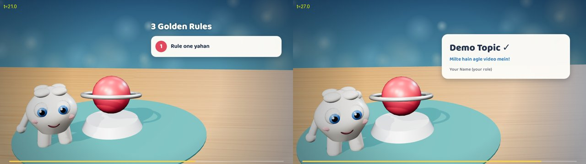

# 🎬 Video Director Skill

**Give this repo to any AI coding agent (Claude Code, Codex, Cursor, Gemini CLI, Hark…) and it can direct and render outstanding, fully finished videos on any topic** — 3D explainers, step-by-step tutorials, medical/dental procedures, horror shorts, product promos, stories, kinetic-type reels — with voice-over, music, subtitles, callout labels and a YouTube thumbnail.

Everything is code: a deterministic three.js scene rendered frame by frame to MP4. No paid video API, no stock footage.


## For the AI agent
Read **[SKILL.md](SKILL.md)** first and follow it end to end. Then `docs/STYLES.md` (genre recipes), `docs/ENGINE.md` (engine + project.json), and study `examples/braces-tutorial/`.

Prompt you can paste into any agent:
> Use the skill at https://github.com/swapagrawal14/video-director-skill (read SKILL.md and follow it exactly). Make a ~3 minute video on **<topic>** for **<audience>** in **<language>**, style **<recipe or "you decide">**. Credit: **<name (role)>**. Deliver the MP4, thumbnail, title, description and tags.

## Quick start (humans)
```bash
git clone https://github.com/swapagrawal14/video-director-skill && cd video-director-skill
bash scripts/setup.sh                         # three.js, fonts, playwright + chromium (needs ffmpeg, node, python3)
bash scripts/new_project.sh projects/demo     # copies the template (working 5-scene demo)
python3 scripts/build_timing.py projects/demo
python3 scripts/shot.py projects/demo 3 9 15 21 27      # preview stills -> projects/demo/shots/sheet.jpg
python3 scripts/music.py projects/demo calm && python3 scripts/mix.py projects/demo
python3 scripts/render_all.py projects/demo --jobs 2
python3 scripts/mux.py projects/demo Demo.mp4
```
Voice-over (optional): `CARTESIA_API_KEY=... CARTESIA_VOICE_ID=... python3 scripts/tts_cartesia.py projects/demo` — or drop your own `vo/s00.wav, s01.wav …`.

Template demo frames:



## Pipeline
`brief → genre recipe → script (project.json) → VO → timing.json → 3D world + per-scene FX → preview stills & QA → music + mix (-16 LUFS) → chunked parallel render → mux → thumbnail + title/tags`

## Made by
**Swapnil Agrawal (BDS intern)** — AI builder & educator · YouTube: *Swap's AI World* · [LinkedIn](https://www.linkedin.com/in/swapnil-agrawal-109a3321b)

MIT licensed. Fonts under OFL. Educational/medical content made with this skill must be verified by a qualified person before use.
