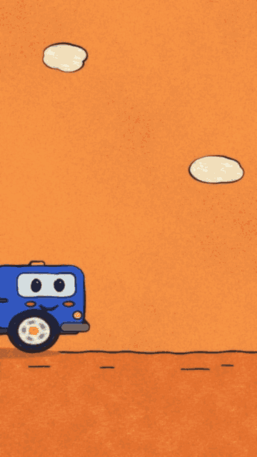

# Hand-drawn finish (frame-by-frame feel) — `motion2d/handdrawn.py`

The finishing layer that makes a motion2d reel read as drawn frame by frame: drawings held on twos, a line
boil that only changes when the drawing changes, re-inked wobbly outlines, marker/crayon/pencil/chalk fills,
paper grain, smears on fast moves, an ink draw-on and an onion-skin debug view. Raster only, never SVG.
Tests: `tests/test_handdrawn.py`. Demo: `examples/truck-sting/` (ZIPZOOM truck sting, 6 s 9:16).

Not to be confused with `docs/HANDDRAWN.md` (the `handdrawn/` whiteboard engine with style packs). That engine
makes pen-on-paper explainers; this module is a finish you put on ANY motion2d / doodle / cartoon reel.

## When to use
- Mascot and logo stings, doodle reels, cartoon shots that should feel hand-animated rather than tweened.
- Not for: 3D (`template/`), screencasts, or clinical close-ups that must stay perfectly sharp and steady.
  The crisp `DOODLE_FINISH` (24 fps, no grain) in `docs/MOTION_DOODLE.md` is still right for a clean vector-ish
  motion-design look; pick one per video, write it in the look sheet.

## The tools
| Function | What it does | Typical setting (1080x1920) |
|---|---|---|
| `on_twos(t, fps)` / `on_threes` / `on_ones` / `hold(t, fps, n)` | `(t_held, drawing)`: animate everything with `t_held`, seed everything with `drawing` | twos for most acting |
| `Holds([(0, 2), (2.9, 1), (3.25, 2)], fps)` | exposure sheet: ones for a slam or fast action, threes for slow settles; drawing count keeps rising | ones only for 0.2-0.4 s |
| `boil(im, drawing, amp, scale, seed)` | line boil keyed only on the drawing index: no shimmer between held frames | amp 1.0-1.4, one seed per layer |
| `paper(W, H, colour)` / `grain(fr, drawing, variants)` | paper plate; multiply the finished frame by tooth+fibre so ink and fills sit on paper | `variants=1` static sheet, 2-3 = pencil-test feel |
| `texture_fill(mask, colour, kind)` / `texturize(sprite, kind, drawing)` | pencil / marker / crayon / chalk media on fills; ink lines untouched | marker 0.6-0.9 on bodies, crayon on ground/dust, chalk on clouds |
| `InkDrawOn(line_art).frame(p)` / `.tip(p)` | pen draw-on: skeleton-traced stroke order, finishes a branch then lifts, round tip at true line width, fills wash in last (exact drawing at p=1) | 0.5-1 s per underline/icon |
| `wobble_outline(sprite, drawing, width, var, wobble)` | re-ink a flat sprite from its alpha: thick-thin brush line, path wobble, thinner inner lines on colour boundaries | width 6-8, var 0.4-0.5 |
| `smear(im, dx, dy, kind)` + `smear_amount(dx, dy)` | `stretch` (classic one-drawing smear), `multiples`, `trail` | only when a drawing moves > ~60 px |
| `spin_smear(wheel, deg)` | rotational blur for wheels, fans, propellers | deg = turn during the exposure |
| `onion_skin(frames, i)` | light-table view: previous drawings red, next green | check arcs and spacing before the full render |

## Recipe (what the truck sting does)
1. Draw/generate the art FLAT (fills, no outline) with moving parts as separate sprites (body, wheels, bubble).
2. Per frame: `t_h, d = HOLDS(t)`; render only when `d` changes and write that image for every frame it holds.
3. Per layer, in this order: transform (squash/rotate) -> `wobble_outline(..., d)` -> `texturize(..., drawing=d % 3)`
   -> smear if fast -> `boil(..., d, seed=layer)` -> paste. Outline BEFORE texture: a broken texture alpha would
   otherwise grow outlines everywhere.
4. Plate = `paper(...)`; last step `grain(fr, d)`.
5. Contact sheet + one `onion_skin` still, look at them, fix, then render. `scripts/qa.py` must PASS.

Cost: the truck sting renders 76 drawings (144 frames) in ~30 s on 2 CPU cores (~0.4 s per drawing), because
held frames are written, not re-rendered. Single calls at 1080x1920: boil ~8 ms, grain ~10 ms, texturize ~50 ms,
draw-on frame ~8 ms (setup ~0.3 s), wobble_outline on a full-frame sprite ~180 ms (sprite-sized is 20-60 ms).

## Honest limits
- It is a finish, not an animator. Real frame-by-frame redraws change construction, volumes and silhouettes;
  here the drawing stays the same and only its line, texture and timing change. Big acting (head turns, new
  silhouettes) still needs extra key poses (pose packs, `inbetween.py`).
- Boil is a displacement of the whole layer: fills wobble with the line. Keep amp <= ~1.6 px.
- `wobble_outline` traces the alpha and flat colour boundaries. Painterly or gradient art gives noisy inner
  lines: use `inner=False`, or skip re-inking and only boil.
- `InkDrawOn` needs dark, fairly clean lines. Hatching and touching letters merge into one stroke group, so the
  order can feel arbitrary; split such art into separate layers and sequence them yourself.
- Paper grain that changes per drawing makes GIFs big (the README gif is blurred and denoised to stay under
  2.5 MB). MP4 at CRF 18 is fine.
- The truck in the demo is drawn in code only so the example runs without an image model. For client work the
  mascot is generated raster art (asset rules in `docs/MOTION_DOODLE.md`) and gets the same finish.

Credit: Swapnil Agrawal (BDS intern).
